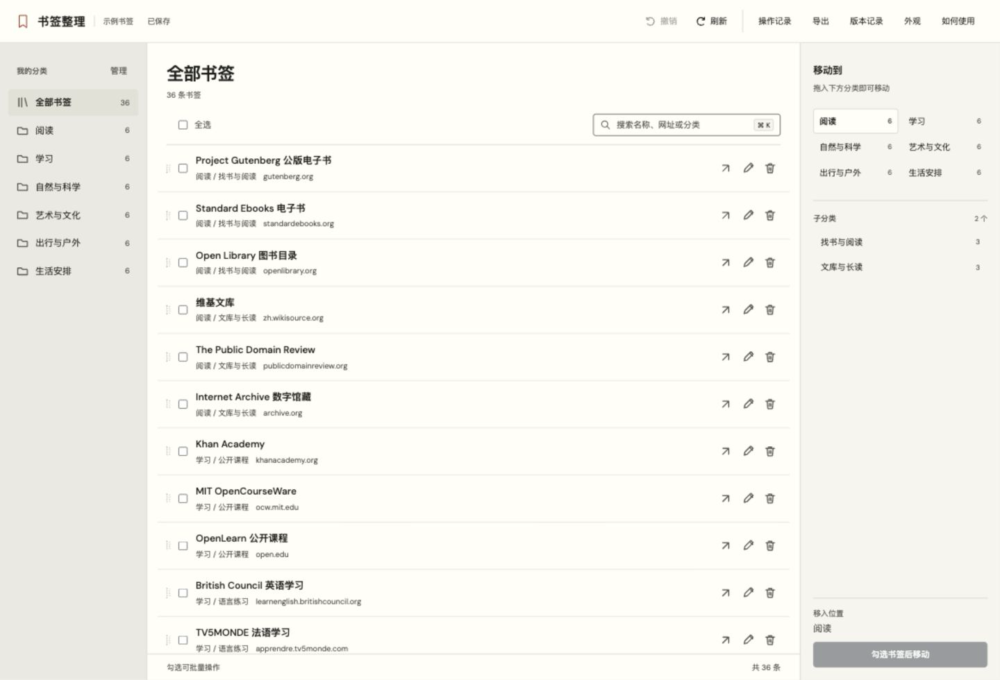

# 书签整理

一个本地优先的 Chrome 书签管理工具。在列表中直接修改名称和网址，拖拽归类，批量整理，并通过操作记录撤销更改。书签直接保存在 Chrome 中，账号同步沿用浏览器设置。

## 安装与打开

Chrome 最低版本为 134。

1. 获取名称以 `-extension.zip` 结尾的扩展包并解压。可使用项目 Releases 中的发行文件，也可从源码构建，步骤见[贡献指南](CONTRIBUTING.md)。
2. 在 Chrome 地址栏打开 `chrome://extensions`，开启开发者模式，点击“加载已解压的扩展程序”。
3. 选择解压后的 `extension` 文件夹。首次安装会打开书签页面，以后点击 Chrome 工具栏中的“书签整理”即可进入。

扩展打开后读取当前 Chrome 个人资料的书签，移动、改名和删除直接保存。普通网页使用示例书签，可用来体验整理操作。“如何使用”提供安装与操作说明。

更新时，解压新版本到原来的 `extension` 加载目录，在扩展管理页点击“重新加载”，再刷新已打开的书签页面。在“外观”中核对实际页面版本。更新前可用“导出完整备份 JSON”保存当前收藏。

在其他设备使用同一批书签时，请在 Chrome 中登录同一个 Google 账号并启用书签保存。设置步骤与异常排查见[同步指引](docs/SYNC.md)。

## 使用

- 左侧一级分类，列表上方二级筛选。一级和二级名称旁的铅笔可原位改名，Enter 保存，Esc 取消。
- 点击书签行右侧的铅笔修改前缀、名称和网址。读取网页标题后仍需保存。
- 勾选多条后，可以设置或清空前缀、批量移动或删除。前缀在列表中以标签呈现，浏览器实际保存 `前缀 · 名称`。
- 拖动书签至右侧一级分类可直接归类，继续悬停展开二级后可放入子分类。
- 单条和分类的垃圾桶，以及批量删除按钮，均会在执行前显示影响范围。合并显示的同名分类会共同改名或删除。
- 分类旁的数量表示网址总数。空子目录会单独说明，删除预览列出所选目录及下级目录。
- “撤销”保留最近 30 次操作。撤销删除会重建内容和分类位置，条目 ID 和创建时间会更新。临时失败后可再次点击撤销继续。已被其他操作修改的条目会保留最新内容，并提示跳过。
- 左侧“我的分类”旁的“管理”打开分类目录，窄窗口可在分类下拉框旁点击“管理分类”。可搜索一级和二级名称，匹配子分类时保留所属一级。展开一级查看二级，点击名称旁的铅笔原位改名，点击加号在当前分类内新建二级。拖动分类行调整同目录顺序，更多菜单提供上下移动、合并和删除。合并保留账号和本机归属，移除空的来源目录。超过两层的既有目录需先整理后再合并。
- “查找重复”按完整网址分组，每组可选一条保留，再确认删除其他条目。查询参数和页面锚点参与比较，每批最多展示 100 组。
- “导入备份”支持浏览器书签 HTML 和完整备份 JSON。先预览，再选择目标目录合入，相同网址跳过。深层目录使用路径名称折叠到二级，单次最大 10 MB、20,000 条书签。导入显示完成数量，可取消并保留已完成内容，再次导入同一文件可继续合入剩余内容。导入采用合入方式，原有书签继续保留。
- “操作记录”可展开查看名称、网址及移动位置的更改前后明细。可按一条记录整次撤销，批量记录会整批恢复。较早的独立操作可直接撤销，后面存在相关更改时会提示先撤销较新的记录。旧版记录缺失的名称或位置会显示编号或未保存提示。
- “导出”可保存书签 HTML、完整备份 JSON 或操作记录 JSON。操作审计最多保留 200 条，导出文件由用户自行管理。
- “外观”提供语言、浅色、深色、跟随系统、4 种强调色、两种列表密度、本机背景图片和存储占用。
- 语言默认跟随浏览器，也可手动选择简体中文、繁体中文、英语、日语、韩语、西班牙语、法语、德语、葡萄牙语（巴西）、俄语、意大利语、阿拉伯语。选择保存在本机，阿拉伯语使用从右向左布局。个人书签名称及分类名称保留原文。
- “操作记录”中的“清空记录”会在确认后清除本机审计和撤销快照。当前书签继续保留，已清空的记录无法恢复。
- “版本”展示版本更新记录及待发布内容。
- 大列表先显示 200 条，点击“再显示”继续加载。搜索和全选作用于全部匹配结果。
- 搜索快捷键为 Command/Control + K，非输入状态可用 Command/Control + Z 撤销。

## 数据与权限

`bookmarks` 用于书签读写，`storage` 用于本机保存操作记录、语言和外观。读取网页标题时，从用户点击的目标地址按站点申请可选权限。请求省略登录凭据，限时读取 HTML，不适用于需要登录或完全由客户端渲染的页面。

字体、图标和翻译随程序提供。示例书签使用公开资源网址，个人书签由浏览器保存。详细数据流、网络请求及清理方法见[隐私说明](PRIVACY.md)。

## 兼容范围

支持 Chrome 134+。第二台真实设备、Chrome 跨版本升级及 Edge、Firefox 的兼容效果仍待验证。12 种界面语言已提供，母语校对仍在完善。测试环境与结果见[兼容与验证](docs/ACCEPTANCE.md)。

## 开发与反馈

项目使用原生 HTML、CSS 和 JavaScript。预览、构建、本地扩展更新及发版步骤见[贡献指南](CONTRIBUTING.md)，版本说明见[更新记录](CHANGELOG.md)。

功能建议和使用问题可通过仓库 Issue 反馈。安全问题请按[安全反馈](SECURITY.md)联系维护者。

代码采用 MIT 许可证。DM Sans 字体采用 SIL Open Font License，许可证随字体附带，图标由本项目绘制。
