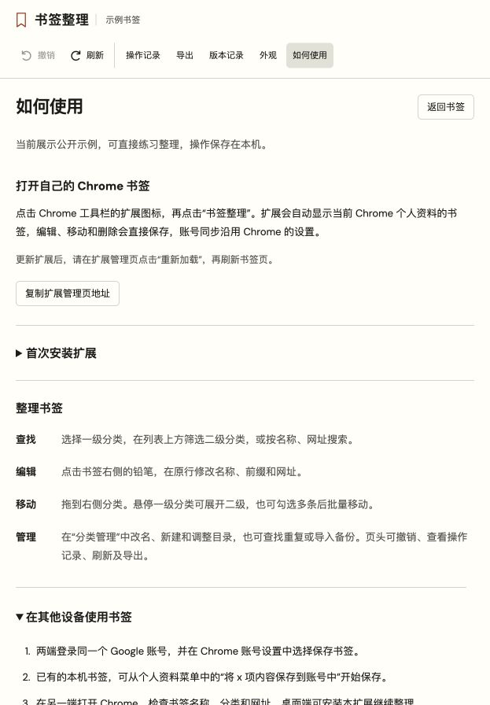

# Chrome 书签同步指引

书签整理会直接读取和保存当前 Chrome 个人资料中的书签。Chrome 将保存在 Google 账号中的书签同步到登录同一账号的其他设备。操作前可通过扩展的“导出完整备份 JSON”保存当前内容。

在扩展的“如何使用”中展开“在其他设备使用书签”，可查看简明步骤和异常排查。

## 设置与使用

1. 在两端 Chrome 登录同一个 Google 账号。
2. 在 Chrome 的账号设置中选择保存书签。已有的本机书签，可从个人资料菜单进入保存到账号的流程。
3. 在另一端检查书签名称、分类和网址。桌面 Chrome 可加载同一份扩展继续整理。
4. 更改书签后，等待 Chrome 完成同步，再在另一端查看。

当前步骤依据 [Google Chrome 官方帮助](https://support.google.com/chrome/answer/165139?hl=zh-Hans)。入口文案可能随 Chrome 版本和账号状态变化，以浏览器实际提示为准。

## 同步范围

书签的名称、网址、文件夹和排序跟随浏览器账号保存。扩展的主题、语言、背景、操作记录与撤销快照保存在本机。另一端的扩展会建立自己的本机记录。

## 常见情况

| 情况 | 检查方法 |
|---|---|
| 另一端看不到书签 | 核对账号，检查收藏是否保存在该账号，以及账号设置中的书签保存选项 |
| 更改暂未出现 | 检查网络及 Chrome 的账号提示，等待同步完成后刷新扩展列表 |
| 要求登录或身份验证 | 按 Chrome 提示完成登录、验证码或同步口令 |

## 确认同步结果

可先保存一条容易识别的书签，再在另一端检查名称、网址和所在文件夹。修改名称或移动分类后，再次核对结果。确认同步正常后，可删除这条临时书签。

当前版本的测试环境与兼容范围见[兼容与验证](ACCEPTANCE.md)。
